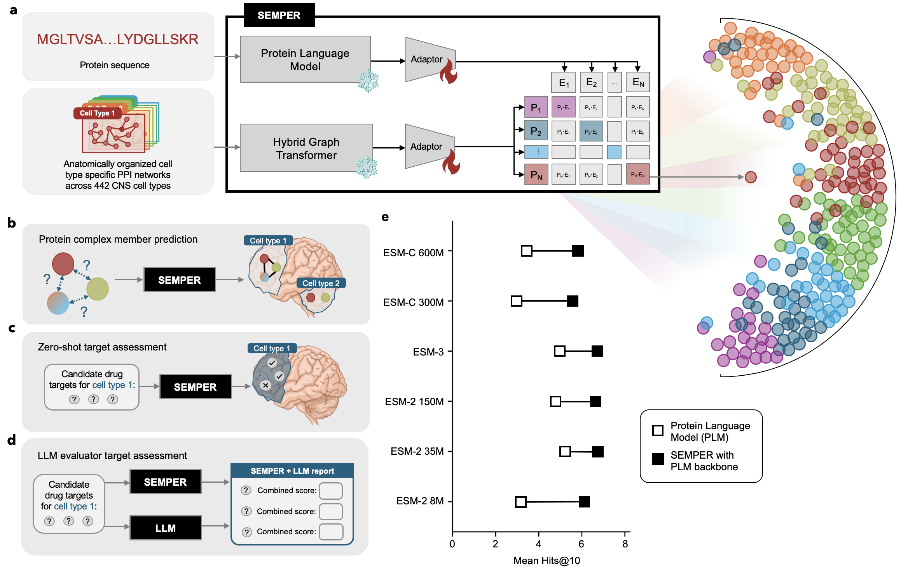

# SEMPER: Multimodal protein representations across human brain cell types

[](https://zitniklab.hms.harvard.edu/SEMPER/)
[](#citation)
[](https://github.com/mims-harvard/SEMPER)
[](LICENSE)

## Overview

The central nervous system (CNS) comprises diverse cell types whose molecular context
shapes the roles of the proteins they express. Characterizing these context-specific
protein functions is important for understanding cellular processes and identifying
disease-relevant therapeutic targets. Protein language models and interactome- or
single-cell-based models capture complementary information from protein sequences and
cellular network contexts.

**SEMPER** (**S**yst**E**m-scale **M**ultimodal **P**rot**E**in **R**epresentations)
captures both in one model. It aligns protein language model representations with
protein–protein interaction (PPI) networks from **442 cell types of the adult human
brain**, giving each protein a sequence-informed representation in every cell type in
which it is expressed. A frozen protein language model (ESM-C 600M) and a frozen graph
transformer trained on these networks are aligned with a symmetric InfoNCE loss on two
small projection heads, giving 1,256,780 protein–cell type representations of 15,487
proteins.

SEMPER representations:

- predict cell type-specific protein complexes,
- predict genes essential to the survival of dopaminergic neurons, measured in a genome-wide CRISPR screen,
- recover clinically pursued drug targets for five neurodegenerative diseases in zero-shot retrieval, at higher rates than existing cell type-specific models, and
- recover more targets when combined with a large language model that reasons over protein functional annotations, with SEMPER providing experimentally derived cellular context that complements the literature-based reasoning of the large language model.

<p align="center">

</p>

**Figure 1.** (a) SEMPER aligns a protein language model and a hybrid graph transformer
over cell type-specific PPI networks through trainable adaptors (frozen encoders shown with
a snowflake). (b–d) Downstream tasks: protein complex membership prediction, zero-shot
target assessment, and LLM-assisted target assessment. (e) SEMPER improves target
retrieval (Hits@10) over the protein language model alone across six backbones.

---

## Repository layout

```
SEMPER/
├── semper/                 # the model
│   ├── esm/                #   1. ESM-C sequence embeddings
│   ├── ppi_gt/             #   2. PPI graph transformer pretraining (multi-GPU DDP)
│   └── contrastive/        #   3. contrastive alignment + final SEMPER representations
├── tutorial/               # end-to-end run on a small demo dataset (start here)
├── data/benchmarks/        # released ground-truth datasets
├── data_prep/              # building cell type PPI networks and parsing Open Targets
├── evaluate/               # scripts behind each figure of the paper
├── img/                    # figures for this README
├── environment.yml         # main environment (training, evaluation)
└── environment_esm.yml     # ESM-C embedding environment
```

---

## Installation

**Requirements:** Linux, an NVIDIA GPU with CUDA 11.8, and conda. Tested on Rocky Linux 8.10
with NVIDIA H100 GPUs.

```bash
git clone https://github.com/mims-harvard/SEMPER.git
cd SEMPER
conda env create -f environment.yml       # about 30 minutes
conda env create -f environment_esm.yml   # about 15 minutes
```

SEMPER uses two environments, matching the ones used for the paper:

| Environment | File | Used for | Key versions |
|---|---|---|---|
| `semper` | `environment.yml` | Network encoder pretraining, contrastive alignment, evaluation | Python 3.8, PyTorch 2.1.0 (CUDA 11.8), PyTorch Geometric 2.6.1 |
| `semper-esm` | `environment_esm.yml` | ESM-C 600M sequence embeddings (`semper/esm/`) | Python 3.10, PyTorch 2.6.0, `esm` 3.2.1.post1 |

The LLM analyses (Figs. 5–6) additionally need `openai` and `tooluniverse` and an Azure
OpenAI or OpenAI API key.

---

## Tutorial

To check that everything works, run the full pipeline on the demo dataset. It trains
SEMPER on four small demo networks, runs zero-shot target retrieval, and makes
paper-style versions of Figs. 2a, 2b–d, 2e, 3b and 4 with the same scripts as the paper.
It takes about 10 minutes on one NVIDIA A100 GPU:

```bash
bash tutorial/run_tutorial.sh
```

The [tutorial README](tutorial/README.md) explains each step, shows the expected outputs
and figures, and describes how to run SEMPER on your own networks.

---

## Released benchmark datasets

[`data/benchmarks/`](data/benchmarks) contains the ground truth used to evaluate SEMPER.
These files can be used to benchmark any protein representation model:

| Dataset | Contents | Paper |
|---|---|---|
| [Cell type-specific protein complexes](data/benchmarks/protein_complexes) | 547 CNS-relevant CORUM complexes and, for each of four complex definitions (transcriptional co-expression, structural connectivity, protein co-abundance, spatial colocalization), the complexes present in each brain cell type with the ten size-matched decoys per complex used for evaluation | Fig. 3, Supplementary Tables 4–5 |
| [Clinically pursued targets](data/benchmarks/clinical_targets) | Targets of drugs and compounds in completed Phase 2 or in Phase 3–4 trials for Alzheimer's disease (130), Parkinson's disease (97), multiple sclerosis (166), Huntington's disease (86) and ALS (98) from the Open Targets Platform. Each target has its clinical phase, ChEMBL/DrugBank drugs, pharmacological action and curated therapeutic intent | Figs. 4–6, Supplementary Table 6 |
| [Dopaminergic neuron essential genes](data/benchmarks/da_neuron_essential_genes) | 693 genes essential to the survival of human iPSC-derived midbrain dopaminergic neurons, from a genome-wide CRISPR/Cas9 screen (Nazeen et al., 2025) | Fig. 5 |

See the [dataset README](data/benchmarks/README.md) for column descriptions and sources.

---

## Training SEMPER

Steps 1 and 2 are independent. Step 3 needs the outputs of both. All scripts run from any
directory and read and write paths relative to the repository root. Each path can be
overridden with an environment variable, as shown in [`tutorial/run_tutorial.sh`](tutorial/run_tutorial.sh).

**Inputs** (place under `data/`, or point the scripts at them):

- `human_background.csv`, the cell type-agnostic interactome ([TransposeNet](https://doi.org/10.6084/m9.figshare.33717070))
- `networks/ppi_edgelists/<cluster>_edgelist.txt`, one PPI network per cell type
- `networks/mg_edgelist.txt`, the metagraph linking cell types, superclusters, brain structures and regions
- `protein_sequences.fasta`, protein sequences, which can be fetched with [`semper/esm/fetch_sequences.py`](semper/esm/fetch_sequences.py)

The 442 brain cell type networks are built with [`data_prep/construct_ppi_networks/`](data_prep/construct_ppi_networks).

### 1 · Sequence embeddings (ESM-C 600M, frozen)

```bash
bash semper/esm/run_esm.sh
```

Writes `outputs/esm/protein_esmc_600m.pt` (`[N_proteins, 1152]`, mean-pooled over residues) and `protein_esmc_600m.pkl` (protein ID → row).

### 2 · PPI graph transformer

```bash
bash semper/ppi_gt/run_ppi_gt.sh      # 4 GPUs by default; NUM_GPUS=1 for one GPU
```

Trains the multi-scale graph transformer with link prediction and center loss for 300
epochs using GraphSAINT mini-batches and DistributedDataParallel. It writes
`outputs/ppi_gt/_protein_embed.pth` (`{cell type → [n_proteins, 64]}`), `_labels_dict.txt`
and the model checkpoint.

<details>
<summary>Arguments of <code>semper/ppi_gt/train.py</code></summary>

| Argument | Description | Default |
|---|---|---|
| `--G_f` | Background interactome CSV | — |
| `--ppi_dir` | Directory of cell type edgelists | — |
| `--mg_f` | Metagraph edgelist | — |
| `--feat_mat` | Initial node feature dimension | `512` |
| `--hidden` | Hidden dimension | `16` |
| `--output` | Output dimension per head | `8` |
| `--n_heads` | Attention heads | `8` |
| `--batch_size` | GraphSAINT mini-batch size | `32` |
| `--epochs` | Training epochs | `300` |
| `--theta` | PPI vs. metagraph loss mixing coefficient | `0.1` |
| `--lmbda` | Center loss weight λ | `0.01` |
| `--lr` | Learning rate | `0.001` |
| `--lr_cent` | Center loss learning rate | `0.01` |
| `--dropout` | Dropout | `0.5` |
| `--save_prefix` | Output prefix | — |

</details>

Training logs to [Weights & Biases](https://wandb.ai) when you are logged in. Set
`WANDB_ENTITY` to choose the entity, or `WANDB_MODE=disabled` to turn logging off.

### 3 · Contrastive alignment and SEMPER representations

```bash
bash semper/contrastive/run_contrastive.sh
```

This trains the two projection heads (sequence 1152 → 1024 → 512 → 512 and network
64 → 512 → 512 → 512) with a symmetric InfoNCE loss (τ = 0.07, batch 64, 200 epochs, Adam,
learning rate 10⁻⁴). It then forms the final representation of protein *p* in cell type *c*:

  **z**<sub>p,c</sub> = normalize( (1 − t) · **u**<sub>p</sub> + t · **v**<sub>p,c</sub> ),  t = 0.10

where **u**<sub>p</sub> is the sequence projection and **v**<sub>p,c</sub> is the cell
type-specific network projection. Proteins without a sequence get the mean sequence projection.

| Output (`outputs/`) | Contents |
|---|---|
| `semper/semper_embed.pth`, `semper_labels.txt` | **SEMPER representations** `{cell type → [n_proteins, 512]}`, used in all analyses |
| `contrastive/clip_mlps.ckpt` | Projection head weights and configuration |
| `contrastive/esm_projected.pth`, `ppi_projected.pth` | Aligned sequence and network projections per cell type |
| `contrastive/joint_projected.pth` | Concatenation of the two (1024-d) |

<details>
<summary>Arguments of <code>train_contrastive_MLP.py</code> and <code>build_semper_embeddings.py</code></summary>

| Argument | Description | Default |
|---|---|---|
| `--embed_path`, `--label_path` | PPI graph transformer embeddings and labels | — |
| `--esm_pickle`, `--esm_embeds` | ESM-C index and embeddings | — |
| `--save_dir` | Output directory | — |
| `--proj_dim` | Shared latent dimension | `512` |
| `--hidden_esm` / `--hidden_ppi` | Hidden layer sizes | `1024 512` / `512 512` |
| `--batch_size`, `--epochs`, `--lr` | Optimization | `64`, `200`, `1e-4` |
| `--temperature` | InfoNCE temperature τ | `0.07` |
| `--seed` | Random seed | `42` |
| `--t` (`build_semper_embeddings.py`) | Weight on the network projection | `0.10` |

</details>

### Hardware

The paper's model was trained on the [Kempner Institute](https://kempner.harvard.edu)
cluster. The graph transformer used 4× NVIDIA H100 (80 GB) with DDP. ESM-C inference and
contrastive alignment used one H100. The tutorial needs one GPU.

---

## Reproducing the paper's analyses

[`evaluate/`](evaluate) holds the scripts behind each figure, with a README per folder:

| Folder | Figure | Analysis |
|---|---|---|
| [`fig1e_plm_backbones/`](evaluate/fig1e_plm_backbones) | 1e | SEMPER vs. its protein language model backbone, for six backbones |
| [`fig2_embedding_space/`](evaluate/fig2_embedding_space) | 2 | Cell type coherence, GO compactness, dopaminergic neuron clusters, tissue co-abundance |
| [`fig3_protein_complexes/`](evaluate/fig3_protein_complexes) | 3 | Cell type-specific protein complex prediction under four complex definitions |
| [`fig4_target_prioritization/`](evaluate/fig4_target_prioritization) | 4 | Zero-shot drug target retrieval for five neurodegenerative diseases |
| [`fig56_llm_evaluator/`](evaluate/fig56_llm_evaluator) | 5–6 | LLM-only baseline, LLM reranking and Gene Ontology tournament |

Target retrieval can be run directly on the released targets. Use
[`make_seedplan.py`](evaluate/fig4_target_prioritization/make_seedplan.py) to generate seed
sets, then the scripts in `run_evaluations/`; the tutorial does exactly this. The
other analyses need SEMPER representations of the 442 brain cell types. These are not
released (see below), so they can be run on representations trained with the code above.

---

## Code and data availability

- **Code:** this repository, MIT License.
- **Benchmark datasets:** [`data/benchmarks/`](data/benchmarks), see [above](#released-benchmark-datasets).
- **Interactome:** TransposeNet is available at [Figshare](https://doi.org/10.6084/m9.figshare.33717070).
- **Cell type networks, representations and model weights:** the 442 cell type PPI networks, the metagraph, and the SEMPER representations and model weights derived from them are not released. The weights are specific to these networks, so to apply SEMPER to another atlas, tissue or organism, retrain on your own networks with the code above.
- **Project website:** https://zitniklab.hms.harvard.edu/SEMPER/

---

## Citation

If you use SEMPER, please cite:

```bibtex
@article{dong2026semper,
  title   = {Multimodal protein representations across human brain cell types},
  author  = {Dong, Amy and Li, Michelle M. and Ding, Kerr and Nazeen, Sumaiya and Noori, Ayush and Huang, Yepeng and Gao, Shanghua and Ritter, Dylan and Afroz, Jalwa and Henderson, Alexander B. H. and Studer, Lorenz and Luo, Yunan and Khurana, Vikram and Parmigiani, Giovanni and Zitnik, Marinka},
  journal = {},
  year    = {2026},
  url     = {https://github.com/mims-harvard/SEMPER}
}
```

Please also cite Nazeen et al. (2025) when using the dopaminergic neuron essential genes, and
the Open Targets Platform when using the target lists.

---

## License

[MIT License](LICENSE)

## Acknowledgements

SEMPER builds on [PINNACLE](https://github.com/mims-harvard/PINNACLE) and the
[ESM](https://github.com/evolutionaryscale/esm) protein language models. We thank the Kempner
Institute for computational resources.
