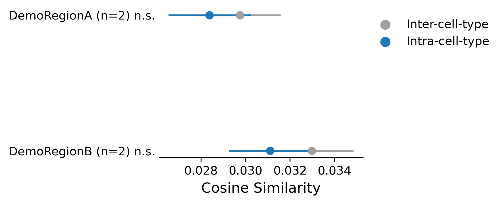
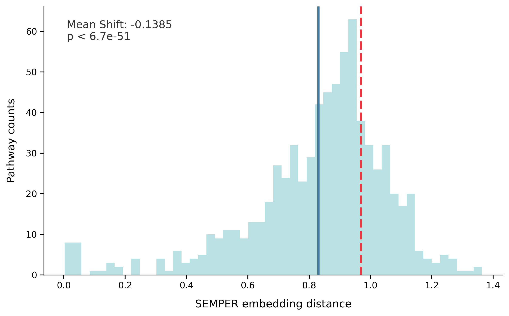
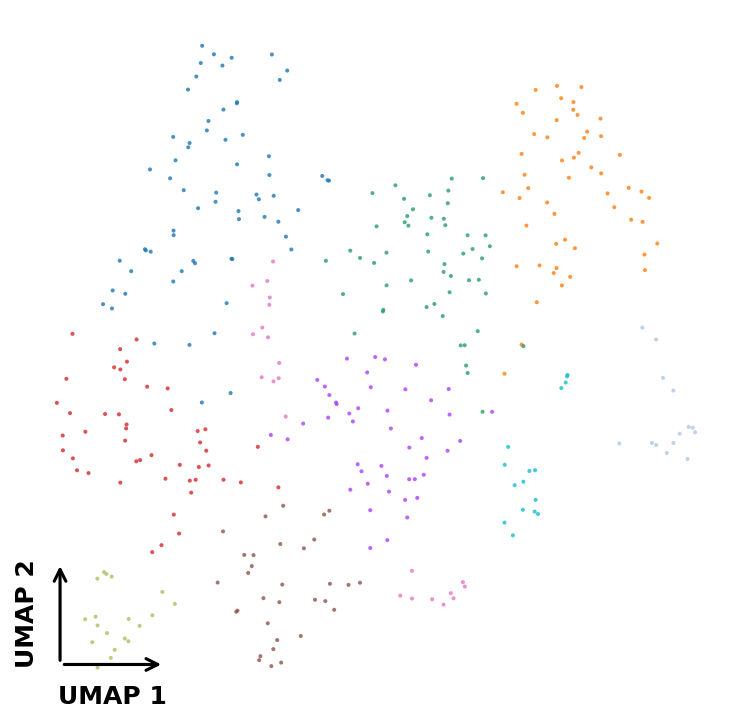
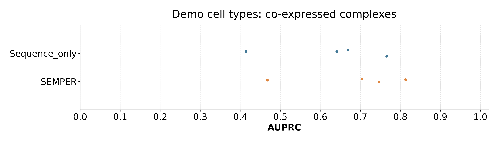
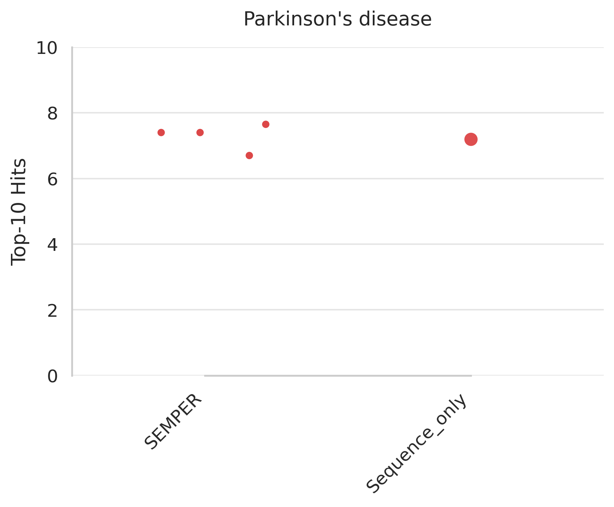

# SEMPER tutorial: train and evaluate on a demo dataset

This tutorial runs the full SEMPER pipeline end to end on a small demo dataset:

1. embed protein sequences with frozen ESM-C 600M,
2. pretrain the PPI graph transformer on cell type networks and a metagraph,
3. align the two modalities with contrastive learning and build the cell type-resolved SEMPER representations,
4. build a seed plan from the Parkinson's disease targets used in the paper,
5. run zero-shot target retrieval and report Hits@k, and
6. make paper-style figures (Figs. 2a, 2b–d, 2e, 3b and 4) from the demo representations.

Every step uses the same scripts as the paper, run with fewer epochs.

## The demo dataset

The paper's 442 cell type networks come from the adult human brain atlas and are not
redistributed. [`demo_data/`](demo_data) instead holds four synthetic "cell type"
networks of about 370 proteins and 5,000 interactions each. Their interactions are real:
they come from the TransposeNet 2 interactome (confidence ≥ 0.5), in the
neighbourhood of the Parkinson's disease targets. The "cell types" are not: each is a
random 75% of that neighbourhood. A two-region metagraph and the proteins' sequences
complete the inputs. [`make_demo_data.py`](make_demo_data.py) shows exactly how it was built.

Because the demo cell types are random subsets of one neighbourhood, the numbers and
figures are not comparable to the paper. The tutorial checks that the code runs and shows
what each step and each analysis produces.

```
demo_data/
├── human_background.csv              # interactome restricted to demo proteins (protein1, protein2, weight, source)
├── protein_sequences.fasta           # 488 sequences (4 proteins have none and get the mean projection)
├── demo_superclusters.csv            # groups the demo cell types by mock region, for the Fig. 2a analogue
└── networks/
    ├── ppi_edgelists/{0..3}_edgelist.txt   # one edgelist per cell type (ENSP IDs)
    └── mg_edgelist.txt                      # metagraph: BTO:DemoBrain -> regions -> cluster:{0..3}
```

Your own data use the same formats, so you can point the scripts at your own networks.

## Requirements

- The `semper` and `semper-esm` conda environments (see the [main README](../README.md#installation))
- One NVIDIA GPU (the graph transformer uses CUDA/NCCL; ESM-C also runs on CPU, slowly)
- Internet access on first run, to download the ESM-C 600M weights

## Run it

From the repository root:

```bash
conda activate semper
bash tutorial/run_tutorial.sh
```

On one NVIDIA A100 (40 GB) the full run takes about 10 minutes: ESM-C embeddings 1.5–3
minutes (plus the one-time weight download), graph transformer pretraining about 4.5
minutes, contrastive alignment, seed planning and retrieval about 1 minute, and the
figures about 2 minutes. Weights & Biases logging is disabled by default
(`WANDB_MODE=disabled`). Epochs can be changed with
`PPI_EPOCHS=... CLIP_EPOCHS=... bash tutorial/run_tutorial.sh`. Step 6 alone can be rerun
with `bash tutorial/run_figures.sh`.

## Expected output

All outputs go to `outputs/tutorial/`:

| Step | Output | Contents |
|---|---|---|
| 1 | `esm/protein_esmc_600m.pt`, `.pkl` | ESM-C embeddings `[488, 1152]` and protein index |
| 2 | `ppi_gt/_protein_embed.pth`, `_labels_dict.txt` | Graph transformer embeddings `{cell type -> [n_proteins, 64]}` |
| 3 | `contrastive/clip_mlps.ckpt`, `*_projected.pth` | Projection heads and aligned sequence and network projections (512-d) |
| 3 | `semper/semper_embed.pth`, `semper_labels.txt` | **SEMPER representations** `{cell type -> [n_proteins, 512]}`, t = 0.10 |
| 4 | `seedplans/PD_seedplan.json` | 20 trials × 15 seed targets per demo cell type |
| 5 | `retrieval/PD_*__trials.csv`, `__summary.csv` | Hits@k per trial and per cell type |
| 6 | `figures/` | The figures below, with their statistics and logs |

Step 5 ends by printing a table like this one (values vary slightly from run to run):

```
Mean Hits@k over demo cell types and trials (demo data, not comparable to the paper):
k                5     10     25
model
SEMPER         4.08  7.49  14.71
Sequence_only  3.95  7.29  14.60
```

`SEMPER` uses the SEMPER representations, and `Sequence_only` uses the aligned sequence
projection alone (t = 0) for comparison.

## Expected figures

Step 6 ([`run_figures.sh`](run_figures.sh)) runs the paper's figure scripts in
[`evaluate/`](../evaluate) on the demo representations. The images below come from a full
run of the tutorial and are kept in [`expected_figures/`](expected_figures). Your figures
should look similar; small differences come from random sampling and GPU training.

**Fig. 2a analogue: within vs. across cell type similarity**
([`fig2a_pairwise_similarity.py`](../evaluate/fig2_embedding_space/fig2a_pairwise_similarity.py)).
Mean cosine similarity of protein pairs within a cell type (blue) and between that cell
type and another (grey), grouped by mock region. The demo cell types are random subsets of
the same proteins, so no within-cell type signal is expected here, unlike the 442 real cell
types in the paper.



**Fig. 2b–d analogue: Gene Ontology term compactness**
([`fig2bcd_go_dispersion.py`](../evaluate/fig2_embedding_space/fig2bcd_go_dispersion.py)).
Mean pairwise cosine distance between proteins that share a GO term (histogram and solid
line) against random protein sets (dashed line), for Biological Process (shown), Cellular
Component and Molecular Function.



**Fig. 2e analogue: proteins of one cell type**
([`fig2e_cluster_and_enrich.py`](../evaluate/fig2_embedding_space/fig2e_cluster_and_enrich.py)).
UMAP of the SEMPER representations of demo cell type 0, colored by Leiden module. The GO
enrichment of each module is written to `figures/fig2e_demo_enrichment.csv`.



**Fig. 3b analogue: protein complex identification**
([`evaluate/fig3_protein_complexes/`](../evaluate/fig3_protein_complexes)). The released CNS
complexes whose subunits are all in a demo cell type network, each with ten size-matched
decoys from the same network, scored by mean pairwise cosine similarity. Each dot is the
AUPRC in one demo cell type (overall AUPRC about 0.70 for SEMPER and 0.63 for the sequence
projection alone).



**Fig. 4 analogue: Parkinson's disease target retrieval**
([`plot_hits_at_k.py`](../evaluate/fig4_target_prioritization/plot_results/plot_hits_at_k.py)).
Mean Hits@10 over the 20 seed sets in each demo cell type (small dots) for SEMPER, and the
overall mean for the sequence projection alone (large dot).



## Using your own data

- **Networks:** one `<cluster>_edgelist.txt` per cell type (space-separated ENSP pairs, connected), a
  tab-separated metagraph whose tissue/region nodes contain `BTO` and whose cell type nodes are
  `cluster:<cluster>`, and a background interactome CSV containing every network protein.
- **Sequences:** a FASTA keyed by ENSP ID, embedded with `semper/esm/run_esm.sh`.
- **Targets:** a JSON with a gene symbol list under `clinically_relevant_targets` (as in
  [`analysis_target_lists/`](../data/benchmarks/clinical_targets/analysis_target_lists)), or any
  CSV with a `targetId_genename` column, works with `make_seedplan.py`.

Then run steps 1–6 with your paths, as in [`run_tutorial.sh`](run_tutorial.sh) and
[`run_figures.sh`](run_figures.sh).
